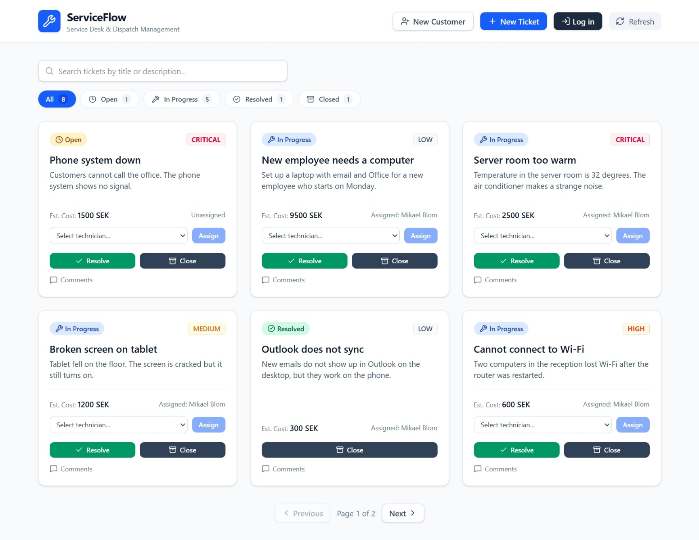

# ServiceFlow

A full-stack service desk app where a company can manage support tickets for its customers. I built it to learn **ASP.NET Core**, **EF Core**, **PostgreSQL** and **React + TypeScript** by doing a real project from start to finish.

**Live demo:** [serviceflow.suhasubasi.se](https://serviceflow.suhasubasi.se)
(log in with `admin` / `admin123` or `tech` / `tech123`)



## What Does It Do?

ServiceFlow is a ticket system for IT support or repair companies. A customer calls with a problem (broken screen, network down, etc.), the company creates a ticket, assigns a technician, and follows it until it is done.

You can:

- Create tickets with title, description, priority and estimated cost
- Assign tickets to technicians
- Move tickets through **Open → In Progress → Resolved → Closed**
- Search tickets by title or description, filter by status, and page through the results
- Write comments on a ticket (for example "Ordered a new part, arrives Thursday")
- Add customers and employees
- Log in with JWT, with two roles: **Admin** and **Technician**

## Roles

| Action | Not logged in | Technician | Admin |
|--------|:---:|:---:|:---:|
| View tickets, customers, employees, comments | ✅ | ✅ | ✅ |
| Create, assign, resolve and close tickets | ❌ | ✅ | ✅ |
| Add customers and comments | ❌ | ✅ | ✅ |
| Delete tickets | ❌ | ❌ | ✅ |
| Add employees | ❌ | ❌ | ✅ |

The backend checks the role (a technician gets `403 Forbidden`). The frontend also hides buttons that the user is not allowed to use.

## Tech Stack

**Backend:** ASP.NET Core 10, Entity Framework Core 10 (Code-First), PostgreSQL, JWT authentication, Swagger

**Frontend:** React 19, TypeScript, Vite, Tailwind CSS 4

**Other:** Docker Compose, xUnit, GitHub Actions, Azure App Service (API), Vercel (frontend)

## Architecture

The backend is split into 3 projects:

```
ServiceFlow.Api              →  Controllers, DTOs, Middleware (HTTP layer)
    ↓
ServiceFlow.Infrastructure   →  EF Core DbContext, services, migrations
    ↓
ServiceFlow.Core             →  Entities, interfaces, enums, value objects
```

- **Core** has no dependencies. It only has the domain model and the interfaces.
- **Infrastructure** implements the interfaces with EF Core and PostgreSQL.
- **Api** is the entry point. It registers everything with Dependency Injection and exposes the REST endpoints.

This way the business rules don't depend on the database or on HTTP.

## How to Run

### Option 1: Docker Compose (easiest)

```bash
docker compose up --build
```

| Service | URL |
|---------|-----|
| PostgreSQL | `localhost:5432` |
| API | `http://localhost:5021` |
| Frontend | `http://localhost:5173` |

The database is created and filled with demo data on the first run.

### Option 2: Run manually

1. Start PostgreSQL (for example only the database container: `docker compose up -d db`)
2. Start the API:
   ```bash
   cd src/ServiceFlow.Api
   dotnet run
   ```
3. Start the frontend:
   ```bash
   cd src/ServiceFlow.Web
   npm install
   npm run dev
   ```

## Demo Logins

| Username | Password | Role |
|----------|----------|------|
| `admin` | `admin123` | Admin |
| `tech` | `tech123` | Technician |

The users are stored in the database with hashed passwords and are seeded on startup from `appsettings.json`. These are demo values only. In production they (and `Jwt:Key`) are set as app settings in Azure.

## API Endpoints

| Method | Endpoint | Auth | Description |
|--------|----------|------|-------------|
| POST | `/api/auth/login` | – | Log in and get a JWT token |
| GET | `/api/tickets` | – | Get all tickets |
| GET | `/api/tickets/search?query=&status=&page=&pageSize=` | – | Search, filter and page tickets |
| GET | `/api/tickets/{id}` | – | Get one ticket |
| GET | `/api/tickets/customer/{customerId}` | – | Tickets for a customer |
| GET | `/api/tickets/employee/{employeeId}` | – | Tickets for an employee |
| POST | `/api/tickets` | Login | Create a ticket |
| PUT | `/api/tickets/{id}/assign` | Login | Assign a technician |
| PUT | `/api/tickets/{id}/resolve` | Login | Mark as resolved |
| PUT | `/api/tickets/{id}/close` | Login | Close a ticket |
| DELETE | `/api/tickets/{id}` | Admin | Delete a ticket |
| GET | `/api/tickets/{id}/comments` | – | Get comments, oldest first |
| POST | `/api/tickets/{id}/comments` | Login | Add a comment |
| GET | `/api/customers` | – | Get all customers |
| GET | `/api/customers/{id}` | – | Get one customer |
| POST | `/api/customers` | Login | Create a customer |
| GET | `/api/employees` | – | Get all employees |
| GET | `/api/employees/{id}` | – | Get one employee |
| POST | `/api/employees` | Admin | Create an employee |

Endpoints with "Login" or "Admin" need an `Authorization: Bearer <token>` header. Swagger is at `http://localhost:5021/swagger` in Development mode.

## Some Design Decisions

- **Money as a value object:** The estimated cost is a `record struct` with Amount and Currency, not just a decimal.
- **State changes on the entity:** The controller calls `ticket.Resolve()` or `ticket.Close()` instead of setting the status directly, so the rules stay inside the entity.
- **Global error handling:** A middleware catches unhandled exceptions and returns a clean ProblemDetails JSON, so the client never sees a stack trace.
- **Validation:** The request DTOs use Data Annotations, so bad input gets a `400` before it reaches the domain.
- **Search on the server:** Search and paging are done in the database with `IQueryable`, `ILIKE` and `Skip`/`Take`, so the API never sends all tickets at once.
- **Comment author from the token:** When you post a comment, the author is read from the JWT, so you can't write a comment as someone else.
- **Cascade delete:** When a ticket is deleted, its comments are deleted too.
- **Auto-migration on startup:** The API applies EF Core migrations and seeds demo data when it starts.

## Tests

```bash
dotnet test
```

- `tests/ServiceFlow.Core.Tests`: unit tests for the domain (ticket status rules, Money, etc.)
- `tests/ServiceFlow.Api.Tests`: integration tests that call the real API against PostgreSQL (auth, roles, customers, employees, tickets, search, comments)

The API tests need PostgreSQL on `localhost:5432`.

## CI/CD

GitHub Actions runs on every push and pull request to `main`:

1. Builds the API and runs all tests against a Postgres container
2. Lints and builds the React frontend
3. Deploys the API to Azure App Service (on `main` only)

The frontend is deployed automatically by Vercel.

## What I Learned

- How to structure an ASP.NET Core API in layers and use Dependency Injection
- EF Core Code-First: entities, relationships, migrations and seeding
- JWT login, hashed passwords and role-based authorization
- Writing integration tests and finding bugs that only showed up in CI
- Connecting a React + TypeScript frontend to a REST API
- Working with branches, pull requests and small commits
- Deploying to Azure and Vercel

